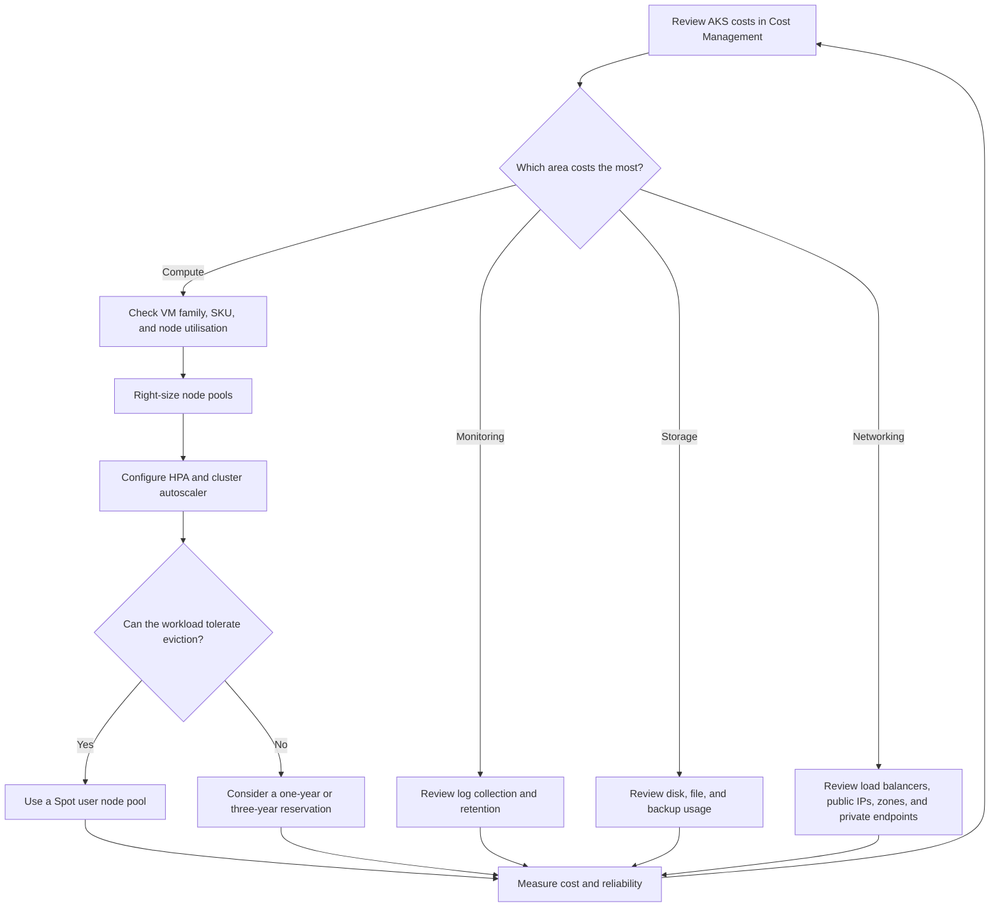

## Table of contents

* [Where AKS costs come from](#where-aks-costs-come-from)
* [How to reduce AKS costs](#how-i-reduce-aks-costs)
* [Cost optimisation flow](#cost-optimisation-flow)
* [Practical techniques](#practical-techniques)
* [Memory line](#memory-line)

## Where AKS costs come from

The biggest AKS cost is normally compute. The worker nodes run as Azure Virtual Machine Scale Sets (VMSS), so choosing the correct VM family, VM size, and number of nodes has the greatest effect on the bill.

An AKS bill can include:

* VMSS instances for system and user node pools
* Load balancers and public IP addresses
* Network traffic between availability zones
* Private endpoint traffic for a private cluster
* The Standard or Premium control plane tier
* Azure Monitor and Log Analytics ingestion and retention
* Azure Disks and Azure Files
* Azure Key Vault
* Cluster backup storage and operations

USers can review these costs in Azure Cost Management at the subscription, resource group, or resource level. Looking at the bill by resource helps you separate node compute from networking, storage, monitoring, and other supporting services.

### What does not normally add a separate AKS charge

Some AKS capabilities do not have a separate charge, although the Azure resources they use might still cost money:

* The control plane when customers use the Free tier
* Managed identities
* AKS extensions themselves, unless an extension has licensing charges or deploys billable resources

## How you can reduce AKS costs

Users can optimise costs at three levels: Kubernetes workloads, the AKS cluster, and the wider Azure subscription.

| Level      | Main focus                                      |
|------------|-------------------------------------------------|
| Kubernetes | Workload efficiency and pod scaling             |
| AKS        | Node compute, autoscaling, and control plane    |
| Azure      | Pricing discounts and supporting resources      |

At the Kubernetes level, you optimise container images for both size and performance. I also use HPA (Horizontal Pod Autoscaller) to scale pods with demand and the cluster autoscaler to add or remove nodes when pods need more or less capacity.

At the AKS level, you can right-size each node pool instead of using one VM type for every workload. You can also use general-purpose, memory-optimised, compute-optimised, or GPU-optimised VM families depending on the workload.

At the Azure level, I can combine usage-based optimisation with commercial discounts:

* Azure Spot Virtual Machines can provide major savings, commonly around 80%, but Azure can evict them when capacity is needed
* Azure reservations provide a discounted rate when I commit to eligible compute for one or three years
* Azure Hybrid Benefit can reduce eligible Windows Server or Linux subscription costs
* Azure Dev/Test subscriptions provide discounted rates for nonproduction environments; I still confirm the support and SLA terms for each service I use

## Cost optimisation flow



## Practical techniques

### Stop nonproduction clusters outside working hours

I can stop a development or test cluster when nobody is using it. This saves the cost of the node pool compute while the cluster is stopped.

```azurecli
az aks stop --name $aks_name --resource-group $aks_rg
az aks start --name $aks_name --resource-group $aks_rg
```

I do not normally stop a production cluster because production workloads need to remain available.

If I only want to stop a user node pool, I use the node pool commands. I keep the system node pool running unless I am stopping the whole cluster.

```azurecli
az aks nodepool stop \
  --cluster-name $aks_name \
  --name $pool_name \
  --resource-group $aks_rg

az aks nodepool start \
  --cluster-name $aks_name \
  --name $pool_name \
  --resource-group $aks_rg
```

### Right-size the VM family and SKU

I match the VM family to the workload instead of choosing a larger VM by default:

* General-purpose VMs for balanced CPU and memory requirements
* Memory-optimised VMs for memory-intensive applications
* Compute-optimised VMs for CPU-intensive applications
* GPU-optimised VMs for AI, machine learning, rendering, or other accelerated workloads

I compare requested resources with actual CPU and memory usage before changing a SKU. This helps me avoid reducing capacity so far that workload performance or reliability suffers.

### Autoscale each node pool

I configure autoscaling rules for node pools independently. When a workload needs less capacity, the cluster autoscaler can reduce the number of nodes in that pool and lower the VMSS cost. HPA and the cluster autoscaler work together: HPA adjusts the pod count, while the cluster autoscaler adjusts the node count when pods cannot be scheduled or nodes are underused.

### Choose the appropriate control plane tier

I choose the control plane tier based on the environment and availability requirements:

| Tier     | Best fit                                          |
|----------|---------------------------------------------------|
| Free     | Development, testing, and learning                |
| Standard | Production workloads that need an uptime SLA      |
| Premium  | Production workloads that need long-term support  |

The Free tier removes the control plane charge, but the worker nodes and other Azure resources are still billed.

### Use Spot node pools for interruptible workloads

I can use Spot node pools in development, testing, or production when the workload can tolerate interruption. Azure can evict Spot nodes at any time, so I use them for batch jobs, stateless applications, and other fault-tolerant workloads. I avoid relying on them for critical stateful workloads or applications that cannot recover from eviction.

## Memory line

I reduce AKS cost by measuring first, right-sizing compute, scaling pods and nodes with demand, using discounts for predictable workloads, and using Spot capacity only for workloads that can be interrupted.
