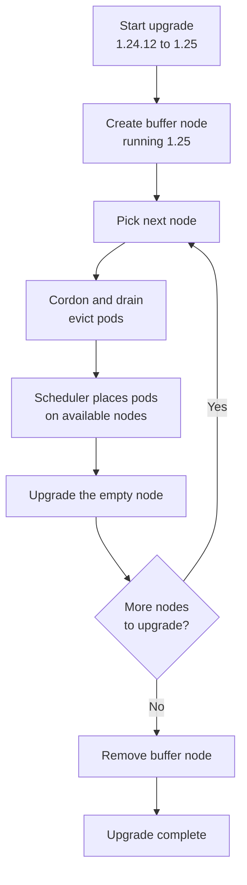

## Table of contents

* [Why I keep node images up to date](#why-i-keep-node-images-up-to-date)
* [Kubernetes version lifecycle](#kubernetes-version-lifecycle)
* [Checking available versions](#checking-available-versions)
* [Ways to upgrade](#ways-to-upgrade)
* [Upgrade a node image with the CLI](#upgrade-a-node-image-with-the-cli)
* [Upgrade the cluster with the CLI](#upgrade-the-cluster-with-the-cli)
* [What happens during a cluster upgrade](#what-happens-during-a-cluster-upgrade)
* [Memory line](#memory-line)

## Why I keep node images up to date

New node image versions contain security patches for the operating system and the tools that run inside the nodes. I upgrade the node images in my cluster regularly to stay compliant with security requirements.

AKS upgrades node images with a rolling upgrade, so it replaces the nodes one by one rather than all at once. This keeps the workloads running while the nodes are patched.

## Kubernetes version lifecycle

Kubernetes releases a new minor version roughly every four months. AKS follows that cadence in stages:

1. A preview version becomes available in AKS about one to two months after the upstream release.
2. The generally available (GA) version follows about one to two months after the preview.
3. Each GA version is then supported for 12 months.

AKS only supports the three latest GA minor versions. Because of this, a cluster admin needs to upgrade at least once a year to stay on a supported version.

| Stage   | Typical timing                    |
|---------|-----------------------------------|
| Preview | 1-2 months after the release      |
| GA      | 1-2 months after the preview      |
| Support | 12 months from GA                 |

## Checking available versions

I can list the Kubernetes versions that AKS offers in a region with:

```powershell
az aks get-versions -l <region> -o table
```

AKS releases are also published in the official [Azure/AKS repository](https://github.com/Azure/AKS/releases) on GitHub, and the release tracker lets me view the rollout by region.

## Ways to upgrade

I can upgrade node images in three ways:

* **Azure portal (manual):** In the cluster's configuration section, I can start the upgrade myself.
* **Automatic upgrades:** I can configure an upgrade channel so AKS automates the process, and I can choose a maintenance window so upgrades only run at a time that suits me.
* **Azure CLI:** I can script the upgrade, as shown in the next sections.

## Upgrade a node image with the CLI

First, I set the variables and create a cluster with three nodes:

```powershell
$AKS_NAME="aks-12-3-452"
$AKS_RG="rg-aks-cluster"

az aks create -g $AKS_RG -n $AKS_NAME --kubernetes-version "<version>" --node-count 3
```

Then I check the current node image version, look for available upgrades, and start the upgrade. The `--node-image-only` flag upgrades only the node images and keeps the current Kubernetes version.

```powershell
# Show the current node image version
az aks nodepool show -g $AKS_RG --cluster-name $AKS_NAME --nodepool-name nodepool1 --query nodeImageVersion

# Look for possible upgrades
az aks nodepool get-upgrades -g $AKS_RG --cluster-name $AKS_NAME --nodepool-name nodepool1

# Start the upgrade: node images only, same Kubernetes version
az aks nodepool upgrade -g $AKS_RG --cluster-name $AKS_NAME --nodepool-name nodepool1 --node-image-only
```

AKS performs a rolling upgrade of the nodes in the node pool.

## Upgrade the cluster with the CLI

To upgrade the Kubernetes version of the whole cluster, I use `az aks upgrade`. The control plane is upgraded first, followed by the node pools.

```powershell
$AKS_NAME="aks-12-3-452"
$AKS_RG="rg-aks-cluster"

# Look for possible cluster upgrades and show them as a table
az aks get-upgrades -g $AKS_RG -n $AKS_NAME -o table

# Start the upgrade: rolling upgrade of the nodes and a new Kubernetes version
az aks upgrade -g $AKS_RG -n $AKS_NAME --kubernetes-version "<version>"
```

## What happens during a cluster upgrade

As an example, I have a cluster with three nodes running Kubernetes 1.24.12, and I want to upgrade to 1.25.

1. When I start the upgrade, AKS creates a buffer node, also called a surge node, that runs the new version (1.25). It adds capacity to the cluster, because some nodes are unavailable during a rolling upgrade.
2. AKS then performs a rolling upgrade. For the first node, it cordons and drains the node, which means it stops scheduling new pods on it and evicts the pods already running there.
3. The evicted pods are rescheduled onto other available nodes, including the buffer node, wherever the scheduler decides.
4. Once the node is empty, AKS upgrades it.
5. AKS moves on to the next node and repeats the cordon, drain, and upgrade steps. Each time, the pods land on whichever nodes are available.
6. When all the nodes are upgraded, the buffer node is no longer needed and is removed.



> [!NOTE]
> The buffer node is a temporary surge node that AKS manages. AKS removes it automatically once the upgrade completes, so I do not normally need to delete it myself. The number of surge nodes can be tuned with the node pool's max surge setting.

## Memory line

I upgrade node images regularly for security patches, and I upgrade the Kubernetes version at least once a year because AKS only supports the three latest GA versions. During an upgrade, AKS adds a surge node, then cordons, drains, and upgrades each node in turn.
