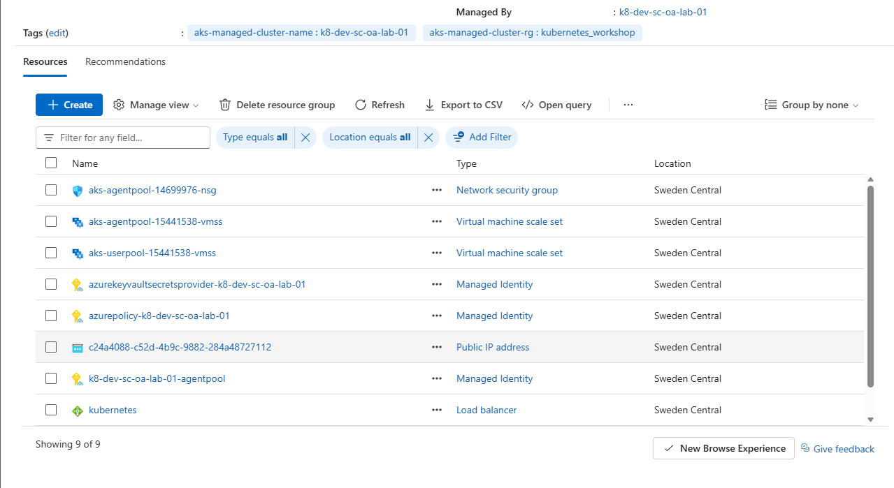
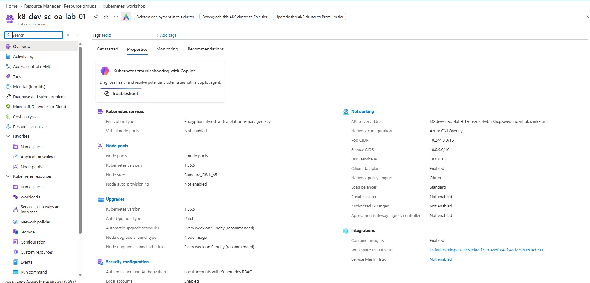
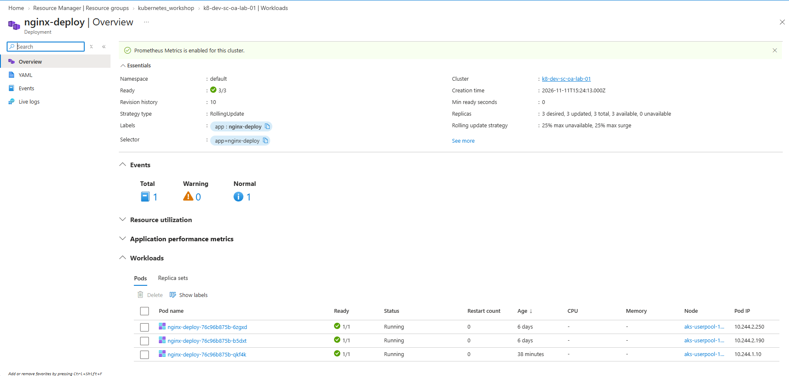
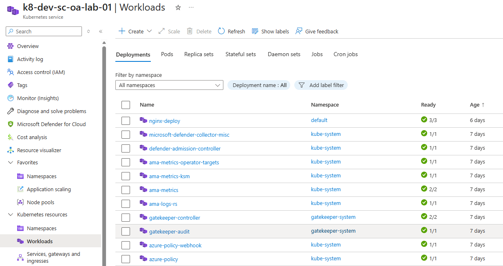
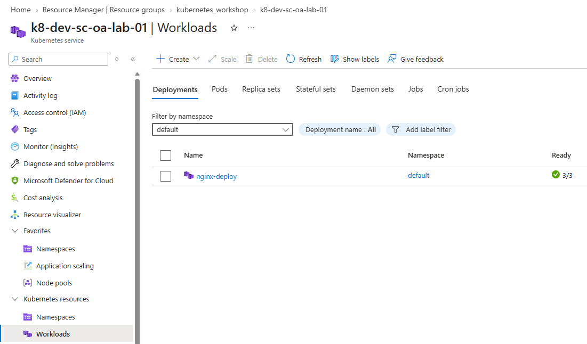
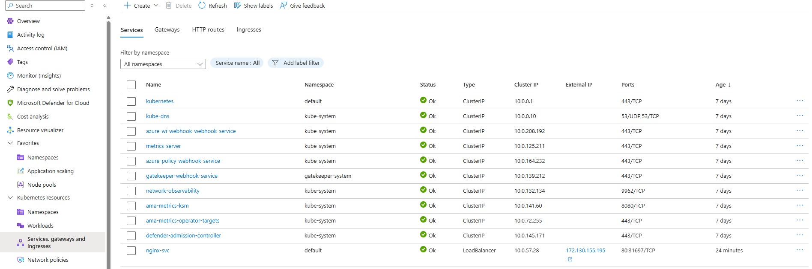
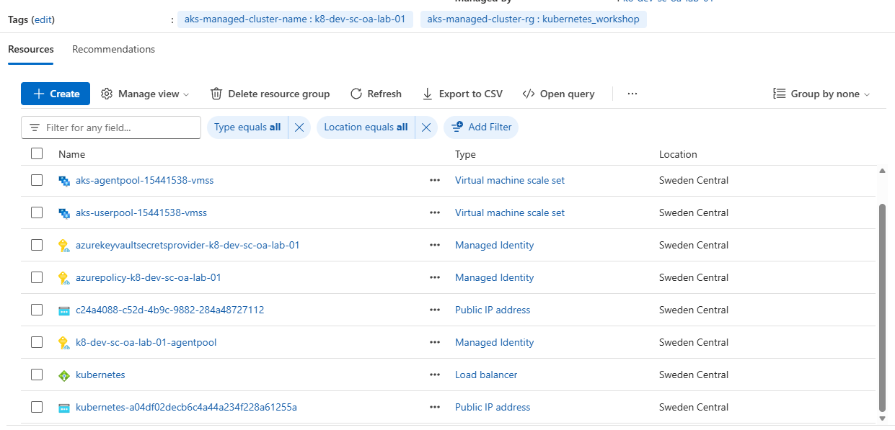
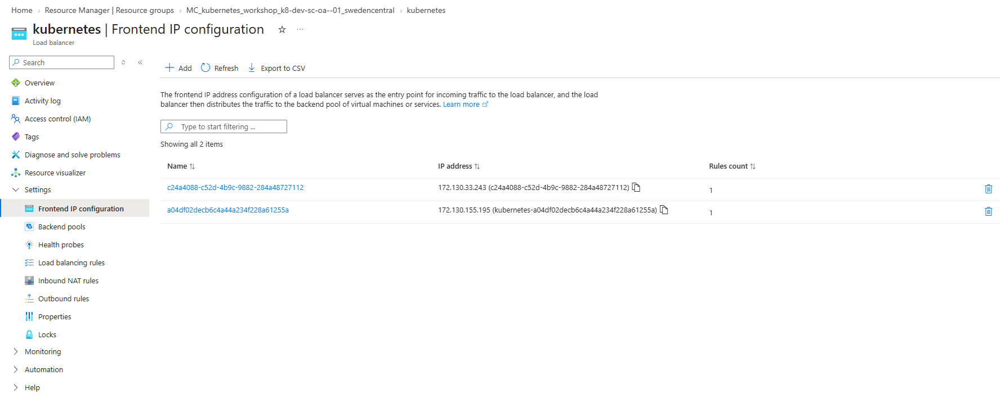

# Kubernetes Setup

This section covers creating an AKS cluster in the Azure portal and the Azure
resources it uses.

## Table of contents

- [Context](#context)
- [Deployment in Azure portal](#deployment-in-azure-portal)
  - [Cluster basics](#cluster-basics)
  - [Identity and node pools](#identity-and-node-pools)
  - [Networking](#networking)
  - [Integrations and security](#integrations-and-security)
  - [Review and create](#review-and-create)
- [Infrastructure](#infrastructure)
  - [Resource groups](#resource-groups)
  - [Inspect and connect to the cluster](#inspect-and-connect-to-the-cluster)
- [Deploying workloads](#deploying-workloads)
  - [Deploy a pod](#deploy-a-pod)
  - [Create a deployment](#create-a-deployment)
- [Working with pods](#working-with-pods)
  - [Exec into pods](#exec-into-pods)
  - [Scale pods](#scale-pods)
- [Services](#services)
  - [Service and load balancer](#service-and-load-balancer)

## Context

| Concept | Description |
| --- | --- |
| AKS cluster | A managed Kubernetes cluster in Azure. |
| Node pool | A group of nodes with the same configuration. |
| Cluster identity | Lets AKS access other Azure resources. |
| Node resource group | Holds the Azure resources used by cluster nodes. |
| Virtual nodes | Let pods run on Azure Container Instances (ACI). |
| Service | Provides a stable address and routes traffic to selected pods. |
| ClusterIP | A Service type that is reachable from inside the cluster. |
| LoadBalancer | A Service type that can expose an application outside the cluster. |
| Network policy | Rules that control traffic between pods. |

## Deployment in Azure portal

### Cluster basics

1. In the Azure portal, search for Kubernetes and select Azure Kubernetes
   Service (AKS).
2. Choose a subscription and resource group, then select a region and
   Kubernetes version.
3. Give the cluster a name, such as `K8-dev-region-name-lab-01`.

### Identity and node pools

The cluster needs an identity to access or create resources, such as an Azure
Load Balancer.

- Choose local accounts or Microsoft Entra ID for authentication. With
  Microsoft Entra ID, configure a group as cluster administrators. Use
  Kubernetes RBAC to control permissions.
- The system (agent) pool runs cluster components. A separate user pool can run
  application workloads. Configure the node size and the minimum and maximum
  node count for each pool.
- Virtual nodes are optional. They let pods run on Azure Container Instances
  (ACI), which can help the cluster add pod capacity quickly. Virtual nodes
  require Azure CNI networking.

### Networking

Choose the networking configuration that fits the cluster:

- **Azure CNI Overlay** assigns pod IP addresses from a separate private
  address range.
- **Azure CNI Node Subnet** (legacy; previously called Azure CNI) assigns pod
  IP addresses from the cluster's virtual network. This can allow direct
  connectivity to resources on the same network.
- You can use your own virtual network. Configure a user-assigned managed
  identity with the required permissions to access it.
- A private cluster uses a private endpoint for the Kubernetes API server.
  The API server is public by default; with a private cluster, access is through
  the cluster's virtual network or connected networks.

### Integrations and security

- Connect the cluster to Azure Container Registry (ACR) using a managed
  identity, rather than storing registry credentials in the cluster.
- Configure monitoring and Azure Policy.
- Enable the Secrets Store CSI driver to let pods retrieve application secrets
  and certificates from Azure Key Vault.
- Choose the encryption options for the cluster.

### Review and create

Review the configuration, then select **Create**.

## Infrastructure

### Resource groups

When you create an AKS cluster, Azure uses two resource groups:

```text
Resource group you select       AKS node resource group (often starts with MC_)
└─ AKS cluster resource         ├─ Virtual machines in a scale set
                                ├─ Disks
                                ├─ Load balancer, when configured
                                └─ Other node resources
```

The resource group you select contains the AKS cluster resource. Azure creates
the node resource group for the resources AKS manages behind the scenes, such as
virtual machines in a scale set and disks. A load balancer may also appear,
depending on the cluster configuration. More enabled features can mean more
resources in this group.



### Inspect and connect to the cluster

In the cluster's overview, check the API server endpoint, Kubernetes version,
and network plugin. To connect with Azure CLI, select the right subscription
and retrieve the cluster credentials:

```powershell
az account set --subscription YOUR_SUBSCRIPTION_ID
az aks get-credentials `
  --resource-group YOUR_RESOURCE_GROUP `
  --name YOUR_CLUSTER_NAME `
  --overwrite-existing
```

The credentials are merged into your kubeconfig file, usually located at
`C:\Users\<username>\.kube\config` on Windows.

Use `kubectl` to inspect the cluster:

```shell
kubectl get nodes
kubectl get nodes -o wide
```

The wide output includes each node's internal IP address. Check that the
address belongs to the node subnet in your virtual network. In the Azure portal,
the node pool shows the node configuration.



## Deploying workloads

After creating a cluster, check the namespaces and common resources that are
already running:

```shell
kubectl get namespaces
kubectl get all --namespace kube-system
```

The `kube-system` namespace contains system pods and other resources needed by
the cluster.

### Deploy a pod

A pod is the smallest deployable unit in Kubernetes. You can create one directly
with `kubectl`:

```shell
kubectl run nginx --image=nginx
```

This creates `pod/nginx`. Kubernetes normally uses YAML manifests to describe
resources. To generate a manifest without creating the pod, run:

```shell
kubectl run nginx --image=nginx --dry-run=client -o yaml > nginx.yaml
```

The output is written to `nginx.yaml`. For example:

```yaml
apiVersion: v1
kind: Pod
metadata:
  labels:
    run: nginx
  name: nginx
spec:
  containers:
    - image: nginx
      name: nginx
      resources: {}
  dnsPolicy: ClusterFirst
  restartPolicy: Always
```

The manifest includes the API version, resource kind, metadata, and pod
specification. Labels can be used to select pods, for example, when routing
traffic. A pod can contain one or more containers. The empty `resources` value
means no resource requests or limits are specified.

Apply the manifest to create the pod:

```shell
kubectl apply -f nginx.yaml
```

You may see a policy warning, depending on how the cluster is configured.
Use one creation method at a time: `kubectl run` creates the pod directly,
while `--dry-run=client` only generates the YAML.

Check the pod:

```shell
kubectl get pods
kubectl get pods -o wide
```

The pod is created in the `default` namespace unless you specify another one.
The wide output includes its IP address. With Azure CNI Overlay, pod IPs come
from a separate range and do not have to match the node subnet.

### Create a deployment

Creating a pod directly gives you one pod. A Deployment is normally used to
manage application pods and keep the requested number running. A Deployment
manages a ReplicaSet, which creates and replaces pods as needed.

```text
Deployment → ReplicaSet → Pods
```

Generate a YAML manifest for a Deployment with two replicas:

```powershell
kubectl create deployment nginx-deploy `
  --image=nginx `
  --replicas=2 `
  --dry-run=client -o yaml > nginx-deploy.yaml
```

The generated manifest looks like this:

```yaml
apiVersion: apps/v1
kind: Deployment
metadata:
  labels:
    app: nginx-deploy
  name: nginx-deploy
spec:
  replicas: 2
  selector:
    matchLabels:
      app: nginx-deploy
  strategy: {}
  template:
    metadata:
      labels:
        app: nginx-deploy
    spec:
      containers:
        - image: nginx
          name: nginx
          resources: {}
```

The Deployment's `spec` sets the number of replicas and the labels used to
select them. The pod template contains the pod's labels and container
specification.

Apply the manifest and check the Deployment and its pods:

```shell
kubectl apply -f nginx-deploy.yaml
kubectl get deployments
kubectl get pods -o wide
```

Each pod has its own IP address and may run on a different node, which can help
keep the application available if a node has a problem.

## Working with pods

### Exec into pods

Use `kubectl exec` to open a shell inside a pod. For example, connect to the
`nginx` pod created earlier:

```shell
kubectl exec -it nginx -- /bin/sh
```

The `-i` and `-t` options open an interactive terminal. Once inside the
container, you can run commands such as `ls`. Run `exit` to leave the shell.

Pods can communicate with each other by using their IP addresses. To see the
pod IPs, run:

```shell
kubectl get pods -o wide
```

If `curl` is available in the container, try sending a request to another pod:

```shell
curl http://10.244.2.190
```

Replace the example IP with the IP of another pod from the command output.
Not every container image includes `curl`, so you may need a debug container
that has it.

By default, pods can communicate across namespaces. Network policies can
restrict this traffic when a supported network policy engine, such as Calico,
is enabled.

### Scale pods

Scale the Deployment to three replicas:

```shell
kubectl scale deployment/nginx-deploy --replicas=3
kubectl get deployment nginx-deploy
kubectl get pods -o wide
```

The output should show three pods, each with its own IP address and node.
Scaling down works the same way; for example, set `--replicas=1`. Kubernetes
removes the extra pods. This command changes the number of pods, not the number
of virtual machines. A configured cluster autoscaler may add nodes if needed.

The AKS portal shows Deployments and pods under **Workloads**. You can filter
the list by namespace:







Pod IP addresses can change when pods are replaced. A Service gives the
application a stable name and keeps track of the pods it selects.

## Services

A Service provides a stable IP address and DNS name for selected pods. Its
selector matches labels on the pods, so the Service can continue routing
traffic when pods are replaced and their IP addresses change.

Create a Service manifest for the `nginx-deploy` Deployment:

```powershell
kubectl expose deployment nginx-deploy --name=nginx-svc --port=80 `
  --dry-run=client -o yaml > nginx-svc.yaml
```

The generated manifest looks like this:

```yaml
apiVersion: v1
kind: Service
metadata:
  labels:
    app: nginx-deploy
  name: nginx-svc
spec:
  ports:
    - port: 80
      protocol: TCP
      targetPort: 80
  selector:
    app: nginx-deploy
```

The manifest defines the Service name, port, target port, and selector. The
selector matches the `app: nginx-deploy` label on the Deployment's pods.

Apply the manifest and check the Service:

```shell
kubectl apply -f nginx-svc.yaml
kubectl get service nginx-svc
kubectl describe service nginx-svc
```

By default, this creates a `ClusterIP` Service, which is reachable from inside
the cluster. Its IP address comes from the Kubernetes Service CIDR, not the
node subnet in the virtual network. The Service's description shows its
selector and endpoints, which are the pods receiving traffic.

You can test the Service by connecting from a pod and requesting its DNS name:

```shell
kubectl exec -it deployment/nginx-deploy -- /bin/sh
curl http://nginx-svc
```

If the container does not have `curl`, use a debug container that does. The
Service routes traffic to a ready pod; the distribution is not guaranteed to
be a strict round-robin pattern.

## Service and load balancer

A `ClusterIP` Service is only reachable from inside the cluster. To make the
application reachable from outside the cluster, change the Service type to
`LoadBalancer`:

```shell
kubectl edit service nginx-svc
```

Set `spec.type` to `LoadBalancer`, then save and close the editor. Check the
Service and wait for its external IP address:

```shell
kubectl get service nginx-svc --watch
```

When the external IP is assigned, open `http://<external-ip>` in a browser to
reach the service.

The AKS portal's **Services, gateways and ingresses** page shows the Service
type and its internal and external IP addresses.



AKS also creates a public IP resource in the node resource group for the
external Service. The load balancer uses this IP address to receive traffic.



