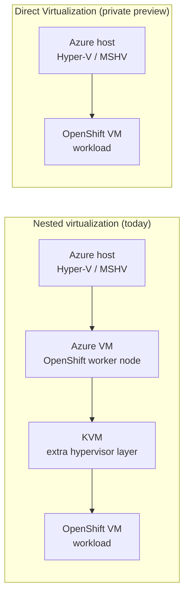
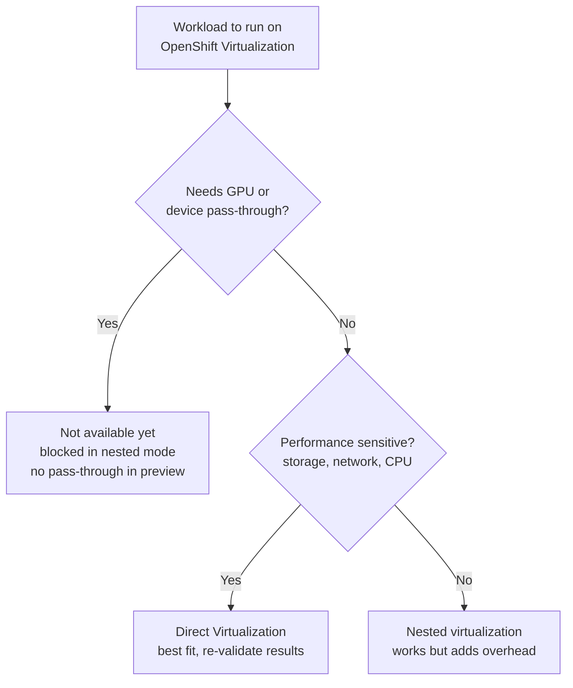

## Table of contents

* [Big-picture understanding](#big-picture-understanding)
* [What virtualization means in this context](#what-virtualization-means-in-this-context)
* [Nested virtualization](#nested-virtualization)
* [Direct Virtualization](#direct-virtualization)
* [Nested vs Direct](#nested-vs-direct)
* [Current status](#current-status)
* [Performance](#performance)
* [Key terms](#key-terms)
* [Summary](#summary)
* [References](#references)

> [!IMPORTANT]
> Nested virtualization is the current bottleneck. Direct Virtualization
> removes that extra layer and should give OpenShift VMs much better
> performance on Azure.

## Big-picture understanding

OpenShift Virtualization on Azure can run in two architectural models:

1. **Nested virtualization** is the current and common model.
2. **Direct Virtualization** is the newer model, in private preview as of
   22/10/2026.

The core difference is how many virtualization layers sit between the
workload VM and the Azure hardware and hypervisor path:

* Nested means there is an extra layer.
* Direct means the extra layer is removed.

That single design change drives most of the performance and capability
discussion.

Today on Azure, OpenShift Virtualization runs in a nested setup, with KVM
running inside an Azure VM. That puts an extra virtualization layer between
the OpenShift VM and the Azure Hyper-V host, and the extra layer adds
overhead, especially for compute, storage, and network I/O.

Direct Virtualization removes that nested layer. OpenShift VMs get more direct
access to the Azure host hypervisor, which is why people describe the result
as "near bare-metal" performance.

## What virtualization means in this context

A virtualization stack is the software path that lets one machine host other
virtual machines. On Azure, two pieces are involved:

* Azure has a host and hypervisor layer, which is Microsoft Hyper-V.
* OpenShift Virtualization also uses virtualization technologies to run VM
  workloads.

If OpenShift VM workloads have to pass through another virtualized layer
first, that is nested virtualization. The two modes look like this:

* In nested mode, the OpenShift VM workloads sit inside a virtualized stack
  that runs inside an Azure VM.
* In direct mode, the workload VMs are presented more like peers or siblings
  in the Azure virtualization landscape, rather than deeply nested guests
  behind another hypervisor layer.

## Nested virtualization

Nested virtualization means virtualization running inside a VM. For example,
KVM or hypervisor functions run inside an Azure VM, rather than having a
direct path to the Azure host hypervisor capabilities.

### Why it matters

Each extra layer introduces:

* Extra CPU overhead
* Extra latency
* Extra context switching and emulation cost
* A less direct I/O path to storage and network devices

### Practical impact

* **There is a performance penalty on Azure.**
* The penalty is worse for storage-intensive and network-intensive workloads.
* GPU workloads are blocked in the nested model, based on my notes and the
  slide.
* The architecture is harder to reason about because of the extra
  indirection.

## Direct Virtualization

Without the extra nested layer:

* The VM execution path is cleaner.
* There is less overhead for compute and I/O.
* VMs have a better chance of near-native behavior.
* The architecture is easier to explain and troubleshoot.

Microsoft's positioning for Direct Virtualization includes:

* Near-native performance
* Non-disruptive servicing, through live migration behavior
* Cloud flexibility, with the normal VM sizing and operations model

## Nested vs Direct

| Area                  | Nested virtualization (today) | Direct Virtualization                |
|-----------------------|-------------------------------|--------------------------------------|
| Virtualization layers | Extra nested hypervisor       | Nested layer removed                 |
| Performance           | Penalty and overhead          | Faster path, acceleration expected   |
| I/O path              | Indirect device access        | More direct I/O path                 |
| GPU workloads         | Blocked in nested mode        | Better fit, but no pass-through yet  |
| Architecture clarity  | More complex                  | Cleaner and easier to reason about   |

## Current status

Direct Virtualization is in private preview with basic VM functionality.
Device pass-through is not available yet, so the two modes compare like this:

1. In nested virtualization, GPU workloads are blocked, based on my notes and
   the slide context.
2. In the Direct Virtualization private preview, basic VM functionality
   exists, but device pass-through is not yet available.

The architecture direction is right, but some high-end workloads still depend
on feature maturity, especially device pass-through and GPU scenarios.

## Performance

### Areas likely to improve

1. **CPU efficiency:** there is less overhead from nested virtualization
   transitions.
2. **Storage throughput and latency:** a more direct I/O path reduces
   indirection.
3. **Network throughput and latency:** for a similar reason, there are fewer
   hops and layers for packet and virtual NIC handling.
4. **Overall VM responsiveness:** there is better scheduling and a lower
   virtualization tax.

> [!CAUTION]
> "Near bare-metal" is usually marketing shorthand for "close to native under
> tested conditions". It does not mean identical in all workloads, so I
> validate the results for my own workloads.

### Benchmark dimensions to track

| Dimension            | What I measure                                |
|----------------------|-----------------------------------------------|
| Compute              | CPU throughput, VM boot, steady-state         |
| Memory               | Latency and bandwidth, stability under load   |
| Storage              | IOPS, throughput, and read/write latency      |
| Network              | Throughput, p95/p99 latency, packet handling  |
| Workload outcomes    | App response time, job time, tail latency     |
| Operational behavior | Live migration, recovery, consistency by size |

## Key terms

| Term                  | Meaning                                           |
|-----------------------|---------------------------------------------------|
| Nested virtualization | VM inside VM style path, with an extra hypervisor |
| Direct Virtualization | No nested layer, cleaner path to Azure hypervisor |
| MSHV / Hyper-V        | Microsoft's Azure host hypervisor                 |
| Device pass-through   | Direct VM access to hardware, key for GPU         |
| ARO                   | Azure Red Hat OpenShift                           |

## Summary

* Nested virtualization on Azure adds an extra hypervisor layer for OpenShift
  VM workloads.
* That extra layer causes performance overhead and blocks some scenarios,
  notably GPU in my current understanding.
* Direct Virtualization removes the nested layer, which makes the architecture
  cleaner and improves the VM and I/O path.
* Early tests indicate acceleration, but the results still need careful
  re-validation.
* The current status is private preview with basic VM support, and device
  pass-through is still a key gap.
* The right mental model is that this is a major architecture improvement with
  measurable upside, but it is still maturing in feature completeness.

## References

* [Direct virtualization performance demos](https://youtu.be/CmihM2eVtlQ?si=JhSjGHeLdJyfIaa0&t=937)
